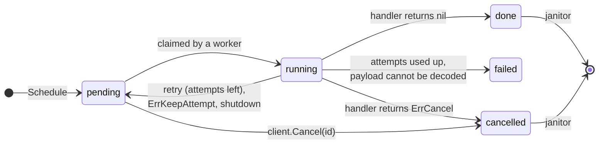

<p align="center">
  <picture>
    <source media="(prefers-color-scheme: dark)" srcset="docs/assets/logo-dark.svg">
    
  </picture>
</p>

<p align="center">
  <b>Delayed background jobs for Go, stored in the Postgres you already run.</b>
</p>

<p align="center">
  <a href="https://pkg.go.dev/github.com/nottolstybai/not-asap"></a>
  <a href="https://github.com/nottolstybai/not-asap/actions/workflows/test.yml"></a>
  <a href="LICENSE"></a>
</p>

---

**notasap** runs background jobs inside your Go service, using one Postgres table as the queue.
There is no broker to deploy. A job is a row, so you can schedule it **in the same transaction**
as your business data: the job exists only if the transaction commits.

```go
tx, _ := pool.Begin(ctx)
orderID := createOrder(ctx, tx, order)                       // your data
client.ScheduleTx(ctx, tx, SendInvoice{OrderID: orderID})    // your job
tx.Commit(ctx)                                               // both or neither
```

It also provides typed handlers, delays, retries with backoff, timeouts, idempotency keys,
a separate worker pool per job kind, crash recovery, graceful shutdown, `slog` logging and Prometheus metrics.

## Quick start

Requires Go 1.26+, PostgreSQL 14+ and [pgx v5](https://github.com/jackc/pgx).

```sh
go get github.com/nottolstybai/not-asap
```

Create the table with the migration from [`migrations/`](migrations) (see [Migrations](#migrations)), then:

```go
package main

import (
	"context"
	"log"
	"os/signal"
	"syscall"
	"time"

	"github.com/jackc/pgx/v5/pgxpool"
	notasap "github.com/nottolstybai/not-asap"
)

// The kind number is stored in the database. Never change or reuse it.
const KindSendInvoice notasap.Kind = 1

type SendInvoice struct {
	OrderID int64 `json:"order_id"`
}

func (SendInvoice) Kind() notasap.Kind { return KindSendInvoice }

func sendInvoice(ctx context.Context, job *notasap.Job[SendInvoice]) error {
	notasap.Logger(ctx).Info("sending invoice", "order_id", job.Payload.OrderID)
	return nil // done
}

func main() {
	ctx, stop := signal.NotifyContext(context.Background(), syscall.SIGINT, syscall.SIGTERM)
	defer stop()

	pool, err := pgxpool.New(ctx, "postgres://localhost:5432/app")
	if err != nil {
		log.Fatal(err)
	}
	defer pool.Close()

	client, err := notasap.New(pool)
	if err != nil {
		log.Fatal(err)
	}
	err = notasap.Register(client, sendInvoice, notasap.KindConfig{Name: "send_invoice"})
	if err != nil {
		log.Fatal(err)
	}
	if err := client.Start(ctx); err != nil {
		log.Fatal(err)
	}

	_, err = client.Schedule(ctx, SendInvoice{OrderID: 42}, notasap.WithDelay(time.Minute))
	if err != nil {
		log.Fatal(err)
	}

	<-ctx.Done()
	stopCtx, cancel := context.WithTimeout(context.Background(), 30*time.Second)
	defer cancel()
	_ = client.Stop(stopCtx)
}
```

A runnable version is in [`examples/basic`](examples/basic).

## How it works

Every job is a row in `notasap_jobs`. Each registered kind has a poller that claims ready rows with
`FOR UPDATE SKIP LOCKED` and hands them to that kind's workers. Replicas share the table and never
claim the same row twice.

An idle poller checks for ready jobs every `PollInterval`. `Schedule` and `ScheduleBatch` also wake
this replica's poller at once when the job has no delay. `ScheduleTx` and `ScheduleBatchTx` do not,
because the job is invisible until your commit; such jobs, and jobs scheduled by other replicas, start
within `PollInterval`. Under a backlog a poller waits up to 20 ms for a quarter of its workers to free up,
so it claims in batches.



> [!NOTE]
> Delivery is **at least once**. A job can run more than once (for example after a crash),
> so handlers must be idempotent.

## Handlers

```go
func handle(ctx context.Context, job *notasap.Job[SendInvoice]) error
```

`job` has `ID`, `Kind`, `Payload`, `Attempt` (starts at 1), `MaxAttempts` and `CreatedAt`.
`ctx` is cancelled when the kind's `Timeout` expires or the client stops, so pass it to every call
that can block. `notasap.Logger(ctx)` returns a logger with `job_id`, `kind` and `attempt` attached.

The return value decides what happens next:

| Handler result | Job status | Attempt spent? |
|---|---|---|
| `nil` | `done` | yes |
| error wrapping `notasap.ErrCancel` | `cancelled` | yes |
| error wrapping `notasap.ErrKeepAttempt` | back to `pending` after backoff | **no** |
| any other error, a panic, or the timeout | `pending` after backoff, or `failed` if no attempts are left | yes |
| payload cannot be decoded | `failed` immediately | yes |
| interrupted by `Stop` | `pending`, runs again right away | **no** |

Sentinels are matched with `errors.Is`, so you can wrap them with a message:

```go
if !order.Paid {
	return fmt.Errorf("order %d not paid: %w", order.ID, notasap.ErrKeepAttempt)
}
```

> [!WARNING]
> `ErrKeepAttempt` has no limit: a job that always returns it lives forever. Stop it yourself,
> for example once `job.CreatedAt` is too old. Watch `notasap_jobs_retried_total{reason="keep_attempt"}`.

Error text is stored in the `error` column, trimmed to 4 KB.

## Scheduling

```go
id, err := client.Schedule(ctx, payload, opts...)                    // standalone
id, err := client.ScheduleTx(ctx, tx, payload, opts...)              // inside your pgx.Tx
res, err := client.ScheduleBatch(ctx, notasap.Item(p1), notasap.Item(p2, opts...))
res, err := client.ScheduleBatchTx(ctx, tx, items...)
```

| Option | Effect |
|---|---|
| `notasap.WithDelay(d)` | the job becomes ready after `d` (database time) |
| `notasap.WithIdempotencyKey(key)` | at most one job per `(kind, key)` while the row exists |
| `notasap.WithReplace()` | with a key: overwrite the existing job instead of returning a duplicate |

Scheduling an unregistered kind returns `ErrUnknownKind` and writes nothing. A batch returns one
`BatchResult{ID, Err}` per item; the per-item `Err` is only `ErrDuplicate` or `ErrJobRunning`.

### Idempotency keys

When a job with the same kind and key already exists:

| Existing job | Without `WithReplace` | With `WithReplace` |
|---|---|---|
| `pending`, `done`, `failed`, `cancelled` | `ErrDuplicate` and the existing ID | overwritten: new payload, `pending`, attempts reset, same ID |
| `running` | `ErrDuplicate` and the existing ID | `ErrJobRunning` and the existing ID |

The key is free again once the janitor deletes the row. Failed jobs are kept forever by default,
so their keys stay taken until you replace them.

```go
id, err := client.Schedule(ctx, SendInvoice{OrderID: 42},
	notasap.WithIdempotencyKey("invoice:42"))
if errors.Is(err, notasap.ErrDuplicate) {
	// already scheduled; id is the existing job
}
```

<details>
<summary>Locking details</summary>

- A `ScheduleBatch` of 2+ keyed items runs in its own transaction: all or nothing.
- A keyed `ScheduleTx` that inserts or replaces a job holds the key until your transaction ends;
  a concurrent schedule of the same key waits. Finding a duplicate locks nothing.
- `WithReplace` does not wait on a `running` row: it returns `ErrJobRunning`. If a worker claims the row
  at that very moment, `ScheduleTx` still returns `ErrJobRunning` but keeps the row locked until your
  transaction ends, and the worker (with the other results of its batch) waits for it. Keep such transactions
  short; see [The table belongs to the library](#the-table-belongs-to-the-library).
- Several keyed schedules in one transaction can deadlock with another transaction; see
  [Keyed jobs in one transaction](#keyed-jobs-in-one-transaction).

</details>

### Cancelling

```go
err := client.Cancel(ctx, id) // nil, ErrJobRunning, ErrJobFinished or ErrNotFound
```

Only `pending` jobs can be cancelled from outside. A running job stops only by its handler's decision.

## Configuration

Client options (all optional):

```go
client, err := notasap.New(pool,
	notasap.WithLogger(slog.Default()),
	notasap.WithObserver(metrics),                                  // see Observability
	notasap.WithDefaults(notasap.KindConfig{Workers: 10}),          // defaults for every kind
	notasap.WithRescuer(notasap.RescuerConfig{Interval: time.Minute}),
	notasap.WithJanitor(notasap.JanitorConfig{BatchSize: 500}),
	notasap.WithStopGrace(10*time.Second),
)
```

`KindConfig` (zero fields fall back to `WithDefaults`, then to the built-in values):

| Field | Default | Meaning |
|---|---|---|
| `Name` | required | name used in logs and metrics |
| `Workers` | `5` | handlers running at the same time |
| `MaxAttempts` | `3` | attempts before the job is `failed` |
| `Timeout` | `1m` | limit for one handler run |
| `Backoff` | `Exponential(5s, 10m)` | delay before a retry (`Constant(d)`, `Exponential(base, max)` or your own func) |
| `PollInterval` | `1s` | how often an idle kind checks for ready jobs |

Background loops:

| Setting | Default | Meaning |
|---|---|---|
| `RescuerConfig.Interval` | `30s` | how often stuck jobs are looked for |
| `RescuerConfig.Grace` | `30s` | extra time after `Timeout` before a running job counts as stuck |
| `JanitorConfig.Interval` | `10m` | how often finished jobs are deleted |
| `JanitorConfig.BatchSize` | `1000` | rows per delete statement |
| `JanitorConfig.Retention` | done `24h`, cancelled `24h`, failed `0` | how long to keep each status; `0` = forever |
| `JanitorConfig.Disabled` | `false` | turn the janitor off (a later `WithJanitor` cannot turn it back on) |
| `WithStopGrace` | `5s` | how long `Stop` waits for cancelled handlers to save their result |

`Retention` is merged per status: `Retention{StatusDone: time.Hour}` keeps the other defaults.
Invalid values are returned as errors by `New` and `Register`, never as a panic at run time.

## Start and stop

```go
err := client.Start(ctx) // checks the table exists, then starts workers and background loops
err := client.Stop(ctx)  // graceful shutdown
```

- `Register` every kind before `Start`. `Schedule` and `Cancel` work in any state.
- `Start` holds the client lock while it checks the schema, so pass a `ctx` with a deadline.
- A client starts once: a second `Start` returns `ErrAlreadyStarted`, `Start` after `Stop` returns `ErrStopped`.

`Stop`:

1. Stops claiming jobs and stops the background loops. A claim already in flight finishes first (up to 10 s)
   and its jobs run.
2. Waits for running handlers until `ctx` is done, then for the writes of their results. If `Stop` returns
   `nil`, every result write has been attempted; a failed write is logged (`write job status`) and the
   rescuer recovers the job.
3. If `ctx` expires, cancels the handlers, waits `StopGrace` for them to return and save, and returns
   `ctx.Err()`. Interrupted jobs go back to `pending` without losing an attempt.

A second concurrent `Stop` waits for the first, so `defer pool.Close()` is safe. After `Stop` returns
`ctx.Err()`, writes may still be in progress (queued results, up to 4000, each batch retried for up to 10 s,
and results of handlers that are still running). Keep the pool open until then, or those writes fail
and the rescuer recovers the jobs.

## Reliability

- **Crashed processes.** A worker claims a job with `deadline = now + Timeout + Grace`. The rescuer (in every
  replica) returns `running` jobs past their deadline to `pending`, or marks them `failed` if no attempts
  are left. A crash spends an attempt, so a job that keeps crashing the process cannot loop forever.
  Such a job is retried only after `Timeout + Grace`, so use a long `Timeout` for long jobs.
- **Stale workers.** Every claim increments a `lease` counter. A worker saves its result only if the lease
  still matches, so a slow worker cannot overwrite the result of a newer run.
- **Handlers that ignore `ctx`.** Go cannot stop a goroutine from outside. After `Timeout + Grace` the job is
  reported as stuck (log and metric) and its worker slot stays busy until the handler returns. Meanwhile the
  rescuer may give the job to another worker, in this process or another replica.
- **Unregistered kinds.** Jobs of a kind that no replica registers stay `pending`.

## Operating in production

The queue is an ordinary table updated in place, so it is only as fast as that table is healthy.

### Long transactions

Every claim and status change leaves a dead row version and index entry. Postgres can remove them only
once they are older than the oldest open snapshot in the cluster (the xmin horizon). While one old
transaction stays open, every claim of every replica steps over all dead entries made since it began,
and claims get slower for all kinds.

The horizon is held by long business transactions (including ones you `ScheduleTx` into), sessions idle in
transaction, `pg_dump`, long analytics queries on the primary, a lagging replication slot, or a standby
with `hot_standby_feedback`.

- Keep `ScheduleTx` transactions short; do not call slow external services inside them.
- Set `idle_in_transaction_session_timeout` and `statement_timeout` for application roles.
- Alert on the age of the oldest transaction (`backend_xmin` in `pg_stat_activity`) and of `xmin` in
  `pg_replication_slots`.

### Autovacuum

A job writes at least three row versions (insert, claim, finish); each retry adds two, and the janitor's
delete one more. Every update changes an indexed column, so none is a HOT update. Dead tuples therefore
appear several times faster than jobs, and default autovacuum thresholds let them pile up. Tune
autovacuum for this table and check that it keeps up (dead tuples and last autovacuum in
`pg_stat_user_tables`).

### Retention and table size

Finished jobs stay until the janitor deletes them: rows ≈ job rate × retention. At 300 jobs/s the default
`24h` keeps about 26M done rows; a few hours is usually enough. Failed jobs are kept forever by default,
together with their idempotency keys; set a retention for them too if failures are frequent.

The janitor runs in every replica, but only one deletes at a time: each batch takes a transaction-level
advisory try-lock, and a replica that does not get it skips that status until the next tick. The lock ends
with the `DELETE`, so it works through PgBouncer in transaction mode.

### Connection pool

Each replica needs **kinds + 3** connections, each held for milliseconds: pollers (one per kind), rescuer,
janitor and the result writer. Your handlers' queries come on top, plus one per handler that may outlive `Stop`.

- Give notasap its own `pgxpool` with `MaxConns` of at least kinds + 3, or size the shared pool accordingly.
  `Start` logs a warning if `MaxConns` is lower.
- Results are saved in batches by one writer (up to 1000 jobs per statement). If 4000 results are already
  waiting, a finished handler keeps its worker slot until there is room, so claiming slows down with the database.
- A status write that fails or gets no connection within 10 s (retries included) is lost for every job of
  the batch (`write job statuses` at Warn, each job at Debug); those jobs run again after `Timeout + Grace`.
- In a handler that holds a transaction, use `ScheduleTx`: `Schedule` and `Cancel` take a second connection,
  and many such handlers can exhaust the pool. If your transaction already locks the key or row
  (for example, it scheduled the same key), `Schedule` or `Cancel` waits on it forever and Postgres cannot
  detect this. There is no `CancelTx`: do not cancel a row your own transaction has locked.

### The table belongs to the library

notasap assumes only it changes `notasap_jobs`.

Allowed:

- Plain `SELECT` (dashboards, debugging): it takes no row locks.
- Foreign keys referencing `notasap_jobs`: they take `FOR KEY SHARE`, which does not conflict with the library.

Not allowed:

- Changing or locking job rows outside the library (`UPDATE`, `DELETE`, `SELECT ... FOR UPDATE` / `FOR SHARE`)
  or long transactions touching the table. A locked `running` row makes result writes wait, and all results
  of that client's batch wait behind it; the rescuer may also run jobs again.
- DDL other than migrations. Create indexes `CONCURRENTLY` and set `lock_timeout` in migrations, so they
  do not queue all queue traffic behind them.

Avoid `ScheduleTx` with `WithReplace` inside a large or long transaction (see
[Idempotency keys](#idempotency-keys)).

### Keyed jobs in one transaction

Two transactions that take the same idempotency keys in opposite order deadlock. Inside one `ScheduleBatch`
or `ScheduleBatchTx` call notasap inserts items in (kind, key) order (keys compared byte-wise), so such
calls do not deadlock each other. It cannot order keys across calls: if one transaction makes several keyed
`ScheduleTx` or `ScheduleBatchTx` calls, use the same (kind, key) order everywhere in your application.
Postgres breaks a deadlock after `deadlock_timeout` by aborting one transaction with SQLSTATE `40P01`;
retry the whole transaction.

### Payloads

Keep payloads small: ids, not documents. The payload is read on every claim, and one larger than about 2 KB
may be compressed or moved out of line (TOAST), which costs extra work each time.

## Observability

**Logs.** Pass a `*slog.Logger` with `WithLogger`. Start, stop and retries are logged at Info, finished jobs
at Debug, failures and panics at Error (with stack trace).

**Prometheus.**

```go
import "github.com/nottolstybai/not-asap/prom"

metrics, err := prom.New(prometheus.DefaultRegisterer,
	prom.WithJobDurationBuckets([]float64{0.1, 0.5, 1, 5, 30}),
)
client, err := notasap.New(pool, notasap.WithObserver(metrics))
```

| Metric | Labels |
|---|---|
| `notasap_jobs_scheduled_total` | `kind` |
| `notasap_jobs_finished_total` | `kind`, `status` (`done`, `failed`, `cancelled`) |
| `notasap_jobs_retried_total` | `kind`, `reason` (`error`, `panic`, `timeout`, `keep_attempt`, `shutdown`) |
| `notasap_job_duration_seconds` | `kind`, `outcome` |
| `notasap_jobs_running` | `kind` |
| `notasap_poll_duration_seconds` | `kind` |
| `notasap_jobs_rescued_total` | `kind` |
| `notasap_jobs_stuck_total` | `kind` |
| `notasap_janitor_deleted_total` | `status` |

For another metrics system, implement `notasap.Observer` (embed `notasap.NopObserver` to override only what you need).

## Migrations

The schema is embedded in the [`migrations`](migrations) package in two formats:

| Tool | Files | Embedded FS |
|---|---|---|
| [goose](https://github.com/pressly/goose) | `migrations/goose/` | `migrations.Goose` |
| [golang-migrate](https://github.com/golang-migrate/migrate) | `migrations/golang-migrate/` | `migrations.GolangMigrate` |

Copy the file into your migrations directory, or run the embedded files with a separate version table
so their numbers do not clash with yours.

The table is always named `notasap_jobs`. To keep it in a separate schema, set `search_path` on the pool.

## License

[MIT](LICENSE)
