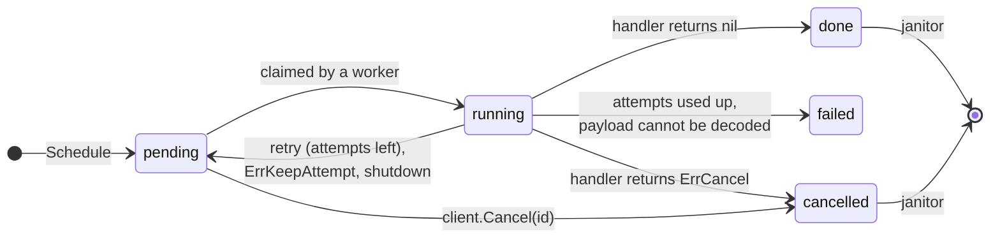

<p align="center">
  <picture>
    <source media="(prefers-color-scheme: dark)" srcset="docs/assets/logo-dark.svg">
    
  </picture>
</p>

<p align="center">
  <b>Delayed background jobs for Go, stored in the Postgres you already run.</b>
</p>

<p align="center">
  <a href="https://pkg.go.dev/github.com/nottolstybai/not-asap"></a>
  <a href="https://github.com/nottolstybai/not-asap/actions/workflows/test.yml"></a>
  <a href="https://github.com/nottolstybai/not-asap/actions/workflows/test.yml"></a>
  
  
  <a href="LICENSE"></a>
</p>

<p align="center">
  <b>English</b> · <a href="README.ru.md">Русский</a>
</p>

---

**notasap** runs background jobs inside your Go service, using one Postgres table as the queue.
There is no broker to deploy. Because a job is a row, you can schedule it **in the same transaction**
as your business data: the job exists only if the transaction commits.

```go
tx, _ := pool.Begin(ctx)
orderID := createOrder(ctx, tx, order)                       // your data
client.ScheduleTx(ctx, tx, SendInvoice{OrderID: orderID})    // your job
tx.Commit(ctx)                                               // both or neither
```

## Contents

- [Features](#features)
- [Quick start](#quick-start)
- [How it works](#how-it-works)
- [Writing handlers](#writing-handlers)
- [Scheduling jobs](#scheduling-jobs)
- [Configuration](#configuration)
- [Running and stopping](#running-and-stopping)
- [Reliability](#reliability)
- [Operating in production](#operating-in-production)
- [Observability](#observability)
- [Migrations](#migrations)
- [Development](#development)
- [License](#license)

## Features

- **Transactional scheduling.** `ScheduleTx` writes the job in your `pgx.Tx`.
- **Typed handlers.** Payloads are plain Go structs; handlers receive them already decoded.
- **Delays, retries, timeouts.** Start a job later, retry it with constant or exponential backoff, and cap each run with a timeout.
- **Idempotency keys.** Schedule the same logical job twice and get the first one back, or replace it on purpose.
- **Per-kind worker pools.** Every job kind has its own workers, so a slow kind never starves the others.
- **Crash recovery.** Jobs of a crashed process are picked up again; late results of a stale worker are rejected.
- **Graceful shutdown.** `Stop` drains running jobs; interrupted jobs go back to the queue without losing an attempt.
- **Housekeeping.** A janitor deletes old finished jobs on a per-status schedule.
- **Observability.** `log/slog` logging and an optional Prometheus collector.

## Quick start

### 1. Install

```sh
go get github.com/nottolstybai/not-asap
```

Requires Go 1.26+, PostgreSQL 14+ and [pgx v5](https://github.com/jackc/pgx).

### 2. Create the table

Apply the migration from [`migrations/`](migrations) with your migration tool
(see [Migrations](#migrations)).

### 3. Define a job and run the client

```go
package main

import (
	"context"
	"log"
	"os/signal"
	"syscall"
	"time"

	"github.com/jackc/pgx/v5/pgxpool"
	notasap "github.com/nottolstybai/not-asap"
)

// The kind number is stored in the database. Never change or reuse it.
const KindSendInvoice notasap.Kind = 1

type SendInvoice struct {
	OrderID int64 `json:"order_id"`
}

func (SendInvoice) Kind() notasap.Kind { return KindSendInvoice }

func sendInvoice(ctx context.Context, job *notasap.Job[SendInvoice]) error {
	notasap.Logger(ctx).Info("sending invoice", "order_id", job.Payload.OrderID)
	return nil // done
}

func main() {
	ctx, stop := signal.NotifyContext(context.Background(), syscall.SIGINT, syscall.SIGTERM)
	defer stop()

	pool, err := pgxpool.New(ctx, "postgres://localhost:5432/app")
	if err != nil {
		log.Fatal(err)
	}
	defer pool.Close()

	client, err := notasap.New(pool)
	if err != nil {
		log.Fatal(err)
	}
	err = notasap.Register(client, sendInvoice, notasap.KindConfig{Name: "send_invoice"})
	if err != nil {
		log.Fatal(err)
	}
	if err := client.Start(ctx); err != nil {
		log.Fatal(err)
	}

	_, err = client.Schedule(ctx, SendInvoice{OrderID: 42}, notasap.WithDelay(time.Minute))
	if err != nil {
		log.Fatal(err)
	}

	<-ctx.Done()
	stopCtx, cancel := context.WithTimeout(context.Background(), 30*time.Second)
	defer cancel()
	_ = client.Stop(stopCtx)
}
```

A runnable version is in [`examples/basic`](examples/basic).

## How it works

Every job is a row in `notasap_jobs`. Each registered kind has a poller that claims
ready rows with `FOR UPDATE SKIP LOCKED` and hands them to that kind's workers.
Replicas of your service share the table and never claim the same row twice.

An idle poller checks for ready jobs every `PollInterval`. `Schedule` and `ScheduleBatch` also wake
this replica's poller at once when they insert a job without a delay. `ScheduleTx` and `ScheduleBatchTx`
do not, because the job is invisible until your commit; such jobs, and jobs scheduled by other replicas,
start within `PollInterval`. Under steady `Schedule` traffic each ready job wakes the poller, so a claim
may fetch a single row: more round trips to the database for lower latency. Under a backlog a poller
waits up to 20 ms for a quarter of its workers to free up, so it claims in batches rather than one row at a time.



> [!NOTE]
> Delivery is **at least once**. A job can run more than once (for example after a crash),
> so handlers must be idempotent.

## Writing handlers

A handler is a function that receives the decoded payload and job metadata:

```go
func handle(ctx context.Context, job *notasap.Job[SendInvoice]) error
```

`job` carries `ID`, `Kind`, `Payload`, `Attempt` (starts at 1), `MaxAttempts` and `CreatedAt`.
`ctx` is cancelled when the kind's `Timeout` expires or the client stops, so pass it to every call
that can block. `notasap.Logger(ctx)` returns a logger with `job_id`, `kind` and `attempt` attached.

What the handler returns decides what happens next:

| Handler result | Job status | Attempt spent? |
|---|---|---|
| `nil` | `done` | yes |
| error wrapping `notasap.ErrCancel` | `cancelled` | yes |
| error wrapping `notasap.ErrKeepAttempt` | back to `pending` after backoff | **no** |
| any other error, a panic, or the timeout | `pending` after backoff, or `failed` if no attempts are left | yes |
| payload cannot be decoded | `failed` immediately | yes |
| interrupted by `Stop` | `pending`, runs again right away | **no** |

Sentinels are matched with `errors.Is`, so wrap them to keep a useful message:

```go
if !order.Paid {
	// The order is not paid yet. Check again later without spending an attempt.
	return fmt.Errorf("order %d not paid: %w", order.ID, notasap.ErrKeepAttempt)
}
```

> [!WARNING]
> `ErrKeepAttempt` has no limit: a job that always returns it lives forever.
> Stop retrying yourself, for example once `job.CreatedAt` is too old.
> Such retries are visible in the metric `notasap_jobs_retried_total{reason="keep_attempt"}`.

Error texts are stored in the `error` column, trimmed to 4 KB on a UTF-8 boundary.

## Scheduling jobs

```go
id, err := client.Schedule(ctx, payload, opts...)                    // standalone
id, err := client.ScheduleTx(ctx, tx, payload, opts...)              // inside your pgx.Tx
res, err := client.ScheduleBatch(ctx, notasap.Item(p1), notasap.Item(p2, opts...))
res, err := client.ScheduleBatchTx(ctx, tx, items...)
```

| Option | Effect |
|---|---|
| `notasap.WithDelay(d)` | the job becomes ready after `d` (database time) |
| `notasap.WithIdempotencyKey(key)` | at most one job per `(kind, key)` while the row exists |
| `notasap.WithReplace()` | with a key: overwrite the existing job instead of returning a duplicate |

Scheduling a kind that is not registered returns `ErrUnknownKind` and writes nothing.
A batch returns one `BatchResult{ID, Err}` per item; per-item `Err` is only `ErrDuplicate` or `ErrJobRunning`.

### Idempotency keys

When a job with the same kind and key already exists:

| Existing job | Without `WithReplace` | With `WithReplace` |
|---|---|---|
| `pending`, `done`, `failed`, `cancelled` | `ErrDuplicate` and the existing ID | the row is overwritten: new payload, `pending`, attempts reset, same ID |
| `running` | `ErrDuplicate` and the existing ID | `ErrJobRunning` and the existing ID |

The key is free again once the janitor deletes the old row. Failed jobs are kept forever by default,
so their keys stay taken until you replace them.

```go
id, err := client.Schedule(ctx, SendInvoice{OrderID: 42},
	notasap.WithIdempotencyKey("invoice:42"))
if errors.Is(err, notasap.ErrDuplicate) {
	// already scheduled; id points to the existing job
}
```

<details>
<summary>Locking details</summary>

- A batch of 2+ items with idempotency keys passed to `ScheduleBatch` runs in its own transaction, so it is all or nothing.
- A keyed `ScheduleTx` that inserts or replaces a job holds the key until your transaction ends:
  a concurrent schedule of the same key waits for it. Finding a duplicate locks nothing.
- `WithReplace` normally does not wait on or lock a row that is already `running`: it returns `ErrJobRunning`
  with the existing ID. If a worker claims the row at the same moment, `ScheduleTx` still returns
  `ErrJobRunning` but keeps the row locked until your transaction ends, and the worker waits for it to save
  the job's result. Keep such transactions short.
- Several keyed schedules in one transaction can deadlock with another transaction; see
  [Keyed jobs in one transaction](#keyed-jobs-in-one-transaction).

</details>

### Cancelling a pending job

```go
err := client.Cancel(ctx, id) // nil, ErrJobRunning, ErrJobFinished or ErrNotFound
```

Only `pending` jobs can be cancelled from outside. A running job stops only by its handler's decision.

## Configuration

Client options (all optional):

```go
client, err := notasap.New(pool,
	notasap.WithLogger(slog.Default()),
	notasap.WithObserver(metrics),                                  // see Observability
	notasap.WithDefaults(notasap.KindConfig{Workers: 10}),          // defaults for every kind
	notasap.WithRescuer(notasap.RescuerConfig{Interval: time.Minute}),
	notasap.WithJanitor(notasap.JanitorConfig{BatchSize: 500}),
	notasap.WithStopGrace(10*time.Second),
)
```

Per-kind settings in `KindConfig`. Zero fields fall back to `WithDefaults`, then to the built-in defaults:

| Field | Default | Meaning |
|---|---|---|
| `Name` | required | name used in logs and metrics |
| `Workers` | `5` | handlers running at the same time |
| `MaxAttempts` | `3` | attempts before the job is `failed` |
| `Timeout` | `1m` | limit for one handler run |
| `Backoff` | `Exponential(5s, 10m)` | delay before a retry (`Constant(d)`, `Exponential(base, max)` or your own func) |
| `PollInterval` | `1s` | how often an idle kind checks for ready jobs |

Background loops:

| Setting | Default | Meaning |
|---|---|---|
| `RescuerConfig.Interval` | `30s` | how often stuck jobs are looked for |
| `RescuerConfig.Grace` | `30s` | extra time after `Timeout` before a running job counts as stuck |
| `JanitorConfig.Interval` | `10m` | how often finished jobs are deleted |
| `JanitorConfig.BatchSize` | `1000` | rows per delete statement |
| `JanitorConfig.Retention` | done `24h`, cancelled `24h`, failed `0` | how long to keep each status; `0` = keep forever |
| `JanitorConfig.Disabled` | `false` | turn the janitor off (cannot be turned back on by a later `WithJanitor`) |
| `WithStopGrace` | `5s` | how long `Stop` waits for handlers to save their result after cancelling them |

`Retention` is merged per status: `Retention{StatusDone: time.Hour}` keeps the other defaults.
Invalid values are reported by `New` and `Register`, never as a panic at run time.

## Running and stopping

```go
err := client.Start(ctx) // checks the table exists, then starts workers and background loops
err := client.Stop(ctx)  // graceful shutdown
```

- `Register` every kind before `Start`. `Schedule` and `Cancel` work in any state.
- `Start` holds the client lock while it checks the schema, so give it a `ctx` with a deadline.
- A client starts once. A second `Start` returns `ErrAlreadyStarted`; `Start` after `Stop` returns `ErrStopped`.

`Stop` works in steps:

1. Stops claiming new jobs and stops the background loops.
   A claim already in flight finishes first (up to 10 s), and its jobs are run.
2. Waits for running handlers until `ctx` is done, then for the writes of their results.
   When `Stop` returns `nil`, every result is saved.
3. If `ctx` expires, cancels the handlers, waits `StopGrace` for them to return and their results
   to be saved, and returns `ctx.Err()`. Interrupted jobs go back to `pending` without losing an attempt.

A second concurrent `Stop` waits for the first one, so `defer pool.Close()` is safe.
If `Stop` returns `ctx.Err()`, handlers that were still running save their result after it returns,
and a result write already in flight may retry for up to 10 s. Keep the pool open that long, or the write
fails and the rescuer recovers the job.

## Reliability

**Crashed processes.** When a worker claims a job it sets `deadline = now + Timeout + Grace`.
If the process dies, the rescuer (running in every replica) finds `running` jobs past their deadline and
returns them to `pending`, or marks them `failed` if no attempts are left. A crash spends an attempt,
so a job that keeps crashing the process cannot loop forever.

> [!IMPORTANT]
> A crashed job is retried only after `Timeout + Grace`. For long jobs use a long `Timeout`.

**Stale workers.** Every claim increments a `lease` counter. A worker saves its result only if the
lease still matches, so a worker that was too slow cannot overwrite the result of a newer run.

**Handlers that ignore `ctx`.** Go cannot stop a goroutine from outside. After `Timeout + Grace` the job
is reported as stuck (log and metric) and its worker slot stays busy until the handler returns.
Meanwhile the rescuer may give the job to another worker, in this process or another replica.

**Unregistered kinds.** Jobs of a kind that no replica registers stay `pending`.

## Operating in production

The queue is an ordinary table updated in place, so it is only as fast as that table is healthy.

### Long transactions

Every claim and every status change leaves a dead row version and a dead index entry behind.
Postgres can remove them, and index scans can skip them cheaply, only once they are older than the
oldest snapshot still open in the cluster (the xmin horizon). While one transaction stays open,
every claim of every replica steps over all dead entries made since it began, and claims get slower
minute by minute for all kinds.

The horizon is held by long business transactions (including the ones you `ScheduleTx` into),
sessions left idle in transaction, `pg_dump` and long analytics queries on the primary,
a lagging replication slot, or a standby with `hot_standby_feedback`.

- Keep `ScheduleTx` transactions short; do not call slow external services inside them.
- Set `idle_in_transaction_session_timeout` (and `statement_timeout`) for application roles.
- Alert on the age of the oldest transaction (`backend_xmin` in `pg_stat_activity`) and of `xmin` in `pg_replication_slots`.

### Dead tuples and autovacuum

A job writes at least three row versions: insert, claim and finish. Each retry adds two more,
and the janitor's delete leaves one more dead row. Every update changes an indexed column,
so none of them is a HOT update, and each one also adds index entries. A queue table therefore
produces dead tuples at several times the job rate, and default autovacuum thresholds, which grow with
the table size, let them pile up between runs. Tune autovacuum for this table to match your load,
and check that it keeps up (dead tuples and last autovacuum in `pg_stat_user_tables`).

### Retention and table size

Finished jobs stay in the table until the janitor deletes them, so done retention decides the table size:
rows ≈ job rate × retention. At 300 jobs/s the default `24h` keeps about 26M done rows; a few hours is
usually enough. Failed jobs are kept forever by default (`failed 0`), together with their idempotency keys;
give them a retention too if failures are frequent.

The janitor runs in every replica, but only one deletes at a time: each batch takes a transaction-level
advisory try-lock keyed by the table, and a replica that does not get it skips that status until its
next tick and moves on to the next one.
The lock ends with the `DELETE` statement, so this works through PgBouncer in transaction mode.

### Connection pool

In each replica the pollers, the rescuer and the janitor use up to kinds + 2 connections at once.
Job results are saved in batches by one writer: a result is written at once if no write is in flight,
otherwise it joins the next write (up to 1000 jobs in one statement). If 4000 results are already
waiting, a finished handler keeps its worker slot until there is room, so claiming slows down with the
database. The writer holds one more connection, so plan for kinds + 3, each held for milliseconds. Your handlers' queries come on top of that.
A status write that gets no connection within 10 s, retries included, is lost for every job in the batch
(`write job status` in the log), and those jobs run again after `Timeout + Grace`.

- Give notasap its own `pgxpool` with `MaxConns` of at least kinds + 3, or size the shared pool for kinds + 3 plus your handlers.
- `Start` logs a warning when `MaxConns` is below kinds + 2.
- In a handler that holds a transaction, use `ScheduleTx`: `Schedule` and `Cancel` take a second connection,
  and many such handlers at once can exhaust the pool. Worse, if that transaction already locks the key or row
  (for example, it scheduled the same key), the handler waits on its own transaction in `Schedule` or `Cancel`,
  and Postgres cannot detect it. There is no `CancelTx`, so do not cancel a row your own transaction has locked.

### Keyed jobs in one transaction

Two transactions that take the same idempotency keys in opposite order deadlock. Within one
`ScheduleBatch` or `ScheduleBatchTx` call notasap inserts items in (kind, key) order, keys compared
byte-wise, so such calls do not deadlock each other. It cannot order keys across calls: if one
transaction makes several keyed `ScheduleTx` or `ScheduleBatchTx` calls, make them in the same
(kind, key) order everywhere in the application. Postgres breaks a deadlock after `deadlock_timeout`
by aborting one transaction with SQLSTATE `40P01`; retry the whole transaction on it.

### Payloads

Keep payloads small: ids, not documents. The payload is read on every claim, and one larger than
about 2 KB may be compressed or moved out of line (TOAST), which costs extra work each time.

## Observability

### Logs

Pass a `*slog.Logger` with `WithLogger`. Start and stop are logged at Info, finished jobs at Debug,
retries at Info, failures and panics at Error (with stack trace).

### Prometheus

```go
import "github.com/nottolstybai/not-asap/prom"

metrics, err := prom.New(prometheus.DefaultRegisterer,
	prom.WithJobDurationBuckets([]float64{0.1, 0.5, 1, 5, 30}),
)
client, err := notasap.New(pool, notasap.WithObserver(metrics))
```

| Metric | Labels |
|---|---|
| `notasap_jobs_scheduled_total` | `kind` |
| `notasap_jobs_finished_total` | `kind`, `status` (`done`, `failed`, `cancelled`) |
| `notasap_jobs_retried_total` | `kind`, `reason` (`error`, `panic`, `timeout`, `keep_attempt`, `shutdown`) |
| `notasap_job_duration_seconds` | `kind`, `outcome` |
| `notasap_jobs_running` | `kind` |
| `notasap_poll_duration_seconds` | `kind` |
| `notasap_jobs_rescued_total` | `kind` |
| `notasap_jobs_stuck_total` | `kind` |
| `notasap_janitor_deleted_total` | `status` |

`scheduled_total` is counted when the insert succeeds, so with `ScheduleTx` it also counts jobs
of transactions that are later rolled back.

To use another metrics system, implement the `notasap.Observer` interface
(embed `notasap.NopObserver` to override only what you need).

## Migrations

The schema ships in two formats, embedded in the [`migrations`](migrations) package:

| Tool | Files | Embedded FS |
|---|---|---|
| [goose](https://github.com/pressly/goose) | `migrations/goose/` | `migrations.Goose` |
| [golang-migrate](https://github.com/golang-migrate/migrate) | `migrations/golang-migrate/` | `migrations.GolangMigrate` |

Either copy the file into your own migrations directory, or run the embedded files with a
**separate version table**, so their numbers never clash with yours:

<details>
<summary>goose</summary>

```go
db := stdlib.OpenDBFromPool(pool) // github.com/jackc/pgx/v5/stdlib
goose.SetBaseFS(migrations.Goose)
goose.SetTableName("notasap_goose_version")
if err := goose.SetDialect("postgres"); err != nil { /* ... */ }
if err := goose.Up(db, "goose"); err != nil { /* ... */ }
```

</details>

<details>
<summary>golang-migrate</summary>

```go
src, _ := iofs.New(migrations.GolangMigrate, "golang-migrate")
m, _ := migrate.NewWithSourceInstance("iofs", src,
	"pgx5://localhost:5432/app?x-migrations-table=notasap_schema_migrations")
if err := m.Up(); err != nil && !errors.Is(err, migrate.ErrNoChange) { /* ... */ }
```

</details>

The table name is always `notasap_jobs`. To keep it in a separate schema, set `search_path` on the pool.

## Development

```sh
make test-unit   # fast tests, no database
make test        # all tests; starts Postgres with testcontainers (needs Docker)
make cover       # coverage report
make vet
```

Set `NOTASAP_TEST_DSN` to run the integration tests against your own database instead of a container.

## License

[MIT](LICENSE). Use it in any project, commercial or not.
