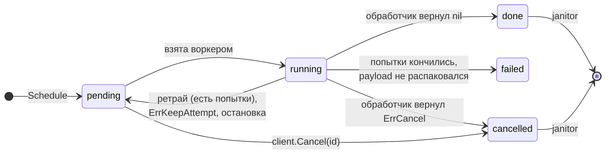

<p align="center">
  <picture>
    <source media="(prefers-color-scheme: dark)" srcset="docs/assets/logo-dark.svg">
    
  </picture>
</p>

<p align="center">
  <b>Отложенные фоновые задачи для Go в том Postgres, который у вас уже есть.</b>
</p>

<p align="center">
  <a href="https://pkg.go.dev/github.com/nottolstybai/not-asap"></a>
  <a href="https://github.com/nottolstybai/not-asap/actions/workflows/test.yml"></a>
  <a href="https://github.com/nottolstybai/not-asap/actions/workflows/test.yml"></a>
  
  
  <a href="LICENSE"></a>
</p>

<p align="center">
  <a href="README.md">English</a> · <b>Русский</b>
</p>

---

**notasap** выполняет фоновые задачи внутри вашего Go-сервиса, а очередью служит одна таблица в Postgres.
Отдельный брокер не нужен. Задача — это строка, поэтому её можно поставить **в той же транзакции**,
что и бизнес-данные: задача появится, только если транзакция закоммитится.

```go
tx, _ := pool.Begin(ctx)
orderID := createOrder(ctx, tx, order)                       // ваши данные
client.ScheduleTx(ctx, tx, SendInvoice{OrderID: orderID})    // ваша задача
tx.Commit(ctx)                                               // либо обе, либо ни одной
```

## Содержание

- [Возможности](#возможности)
- [Быстрый старт](#быстрый-старт)
- [Как это работает](#как-это-работает)
- [Обработчики](#обработчики)
- [Постановка задач](#постановка-задач)
- [Настройка](#настройка)
- [Запуск и остановка](#запуск-и-остановка)
- [Надёжность](#надёжность)
- [Эксплуатация](#эксплуатация)
- [Наблюдаемость](#наблюдаемость)
- [Миграции](#миграции)
- [Разработка](#разработка)
- [Лицензия](#лицензия)

## Возможности

- **Постановка в транзакции.** `ScheduleTx` пишет задачу в ваш `pgx.Tx`.
- **Типизированные обработчики.** Payload — обычная Go-структура, обработчик получает её уже распакованной.
- **Задержки, ретраи, таймауты.** Задачу можно запустить позже, повторить с постоянной или экспоненциальной задержкой и ограничить каждый запуск по времени.
- **Ключи идемпотентности.** Повторная постановка той же задачи вернёт первую, а при желании перезапишет её.
- **Свой пул воркеров на каждый kind.** Медленный вид задач не отнимает воркеров у остальных.
- **Восстановление после падений.** Задачи упавшего процесса снова берутся в работу, а запоздавший результат старого воркера отбрасывается.
- **Плавная остановка.** `Stop` дожидается текущих задач; прерванные задачи возвращаются в очередь без траты попытки.
- **Уборка.** Janitor удаляет старые завершённые задачи по расписанию для каждого статуса.
- **Наблюдаемость.** Логи через `log/slog` и готовый коллектор Prometheus.

## Быстрый старт

### 1. Установка

```sh
go get github.com/nottolstybai/not-asap
```

Нужны Go 1.26+, PostgreSQL 14+ и [pgx v5](https://github.com/jackc/pgx).

### 2. Создайте таблицу

Примените миграцию из [`migrations/`](migrations) своим инструментом миграций
(см. [Миграции](#миграции)).

### 3. Опишите задачу и запустите клиент

```go
package main

import (
	"context"
	"log"
	"os/signal"
	"syscall"
	"time"

	"github.com/jackc/pgx/v5/pgxpool"
	notasap "github.com/nottolstybai/not-asap"
)

// Номер kind хранится в базе. Никогда не меняйте и не переиспользуйте его.
const KindSendInvoice notasap.Kind = 1

type SendInvoice struct {
	OrderID int64 `json:"order_id"`
}

func (SendInvoice) Kind() notasap.Kind { return KindSendInvoice }

func sendInvoice(ctx context.Context, job *notasap.Job[SendInvoice]) error {
	notasap.Logger(ctx).Info("sending invoice", "order_id", job.Payload.OrderID)
	return nil // done
}

func main() {
	ctx, stop := signal.NotifyContext(context.Background(), syscall.SIGINT, syscall.SIGTERM)
	defer stop()

	pool, err := pgxpool.New(ctx, "postgres://localhost:5432/app")
	if err != nil {
		log.Fatal(err)
	}
	defer pool.Close()

	client, err := notasap.New(pool)
	if err != nil {
		log.Fatal(err)
	}
	err = notasap.Register(client, sendInvoice, notasap.KindConfig{Name: "send_invoice"})
	if err != nil {
		log.Fatal(err)
	}
	if err := client.Start(ctx); err != nil {
		log.Fatal(err)
	}

	_, err = client.Schedule(ctx, SendInvoice{OrderID: 42}, notasap.WithDelay(time.Minute))
	if err != nil {
		log.Fatal(err)
	}

	<-ctx.Done()
	stopCtx, cancel := context.WithTimeout(context.Background(), 30*time.Second)
	defer cancel()
	_ = client.Stop(stopCtx)
}
```

Готовый к запуску вариант лежит в [`examples/basic`](examples/basic).

## Как это работает

Каждая задача — строка в `notasap_jobs`. У каждого зарегистрированного kind есть поллер:
он забирает готовые строки через `FOR UPDATE SKIP LOCKED` и раздаёт их воркерам этого kind.
Реплики сервиса работают с одной таблицей и никогда не забирают одну строку дважды.

Поллер без работы проверяет готовые задачи раз в `PollInterval`. `Schedule` и `ScheduleBatch` вдобавок
сразу будят поллер своей реплики, если вставили задачу без задержки. `ScheduleTx` и `ScheduleBatchTx`
этого не делают: до вашего коммита задачи не видно. Такие задачи, как и поставленные другими репликами,
стартуют в пределах `PollInterval`. При равномерном потоке `Schedule` каждая готовая задача будит поллер,
и захват может забирать по одной строке: больше запросов к базе ради меньшей задержки. Когда задач скопилось
много, поллер ждёт до 20 мс, пока освободится четверть его воркеров, и забирает задачи пачками, а не по одной.



> [!NOTE]
> Гарантия доставки — **at least once**. Задача может выполниться больше одного раза
> (например, после падения процесса), поэтому обработчики должны быть идемпотентными.

## Обработчики

Обработчик — функция, которая получает распакованный payload и данные о задаче:

```go
func handle(ctx context.Context, job *notasap.Job[SendInvoice]) error
```

В `job` есть `ID`, `Kind`, `Payload`, `Attempt` (начинается с 1), `MaxAttempts` и `CreatedAt`.
`ctx` отменяется, когда истекает `Timeout` kind'а или клиент останавливается, поэтому передавайте его
во все вызовы, которые могут зависнуть. `notasap.Logger(ctx)` возвращает логгер с полями `job_id`, `kind` и `attempt`.

Что вернёт обработчик, то и случится с задачей:

| Результат обработчика | Статус задачи | Попытка тратится? |
|---|---|---|
| `nil` | `done` | да |
| ошибка, оборачивающая `notasap.ErrCancel` | `cancelled` | да |
| ошибка, оборачивающая `notasap.ErrKeepAttempt` | снова `pending` после задержки | **нет** |
| любая другая ошибка, паника или таймаут | `pending` после задержки или `failed`, если попыток не осталось | да |
| payload не распаковывается | сразу `failed` | да |
| прервана через `Stop` | `pending`, запускается снова сразу | **нет** |

Сигнальные ошибки проверяются через `errors.Is`, поэтому их можно оборачивать с понятным текстом:

```go
if !order.Paid {
	// Заказ ещё не оплачен. Проверим позже, не тратя попытку.
	return fmt.Errorf("order %d not paid: %w", order.ID, notasap.ErrKeepAttempt)
}
```

> [!WARNING]
> У `ErrKeepAttempt` нет лимита: задача, которая всегда его возвращает, живёт вечно.
> Останавливайтесь сами, например когда `job.CreatedAt` слишком старый.
> Такие повторы видны в метрике `notasap_jobs_retried_total{reason="keep_attempt"}`.

Текст ошибки сохраняется в колонке `error`, обрезанный до 4 КБ по границе символа UTF-8.

## Постановка задач

```go
id, err := client.Schedule(ctx, payload, opts...)                    // отдельно
id, err := client.ScheduleTx(ctx, tx, payload, opts...)              // внутри вашего pgx.Tx
res, err := client.ScheduleBatch(ctx, notasap.Item(p1), notasap.Item(p2, opts...))
res, err := client.ScheduleBatchTx(ctx, tx, items...)
```

| Опция | Что делает |
|---|---|
| `notasap.WithDelay(d)` | задача станет готовой через `d` (по времени базы) |
| `notasap.WithIdempotencyKey(key)` | не больше одной задачи на `(kind, key)`, пока строка существует |
| `notasap.WithReplace()` | вместе с ключом: перезаписать существующую задачу вместо ошибки о дубле |

Постановка незарегистрированного kind возвращает `ErrUnknownKind` и ничего не пишет.
Батч возвращает по `BatchResult{ID, Err}` на каждый элемент; `Err` элемента — только `ErrDuplicate` или `ErrJobRunning`.

### Ключи идемпотентности

Если задача с тем же kind и ключом уже есть:

| Существующая задача | Без `WithReplace` | С `WithReplace` |
|---|---|---|
| `pending`, `done`, `failed`, `cancelled` | `ErrDuplicate` и ID существующей | строка перезаписывается: новый payload, `pending`, попытки сброшены, ID тот же |
| `running` | `ErrDuplicate` и ID существующей | `ErrJobRunning` и ID существующей |

Ключ снова свободен, когда janitor удаляет старую строку. Задачи в `failed` по умолчанию хранятся вечно,
поэтому их ключи заняты, пока вы их не перезапишете.

```go
id, err := client.Schedule(ctx, SendInvoice{OrderID: 42},
	notasap.WithIdempotencyKey("invoice:42"))
if errors.Is(err, notasap.ErrDuplicate) {
	// уже поставлена; id указывает на существующую задачу
}
```

<details>
<summary>Подробности о блокировках</summary>

- Батч из 2+ элементов с ключами идемпотентности, переданный в `ScheduleBatch`, выполняется в отдельной транзакции: либо всё, либо ничего.
- Если `ScheduleTx` с ключом вставил или перезаписал задачу, ключ занят до конца вашей транзакции:
  параллельная постановка с тем же ключом ждёт её. Если найден дубль, ничего не блокируется.
- Обычно `WithReplace` не ждёт и не блокирует строку, которая уже в `running`: он возвращает `ErrJobRunning`
  и ID существующей задачи. Если воркер забирает строку в тот же момент, `ScheduleTx` всё равно вернёт
  `ErrJobRunning`, но строка останется заблокированной до конца вашей транзакции, и воркер будет ждать её,
  чтобы сохранить результат. Держите такие транзакции короткими.
- Несколько постановок с ключами в одной транзакции могут попасть во взаимную блокировку с другой транзакцией; см.
  [Несколько ключей в одной транзакции](#несколько-ключей-в-одной-транзакции).

</details>

### Отмена задачи в очереди

```go
err := client.Cancel(ctx, id) // nil, ErrJobRunning, ErrJobFinished или ErrNotFound
```

Снаружи можно отменить только задачу в `pending`. Выполняющуюся задачу останавливает только её обработчик.

## Настройка

Опции клиента (все необязательные):

```go
client, err := notasap.New(pool,
	notasap.WithLogger(slog.Default()),
	notasap.WithObserver(metrics),                                  // см. «Наблюдаемость»
	notasap.WithDefaults(notasap.KindConfig{Workers: 10}),          // значения для всех kind
	notasap.WithRescuer(notasap.RescuerConfig{Interval: time.Minute}),
	notasap.WithJanitor(notasap.JanitorConfig{BatchSize: 500}),
	notasap.WithStopGrace(10*time.Second),
)
```

Настройки kind в `KindConfig`. Пустые поля берутся из `WithDefaults`, затем из встроенных значений:

| Поле | По умолчанию | Значение |
|---|---|---|
| `Name` | обязательно | имя для логов и метрик |
| `Workers` | `5` | сколько обработчиков работает одновременно |
| `MaxAttempts` | `3` | сколько попыток до `failed` |
| `Timeout` | `1m` | лимит на один запуск обработчика |
| `Backoff` | `Exponential(5s, 10m)` | задержка перед ретраем (`Constant(d)`, `Exponential(base, max)` или своя функция) |
| `PollInterval` | `1s` | как часто kind без работы проверяет готовые задачи |

Фоновые процессы:

| Настройка | По умолчанию | Значение |
|---|---|---|
| `RescuerConfig.Interval` | `30s` | как часто искать зависшие задачи |
| `RescuerConfig.Grace` | `30s` | запас после `Timeout`, прежде чем задача считается зависшей |
| `JanitorConfig.Interval` | `10m` | как часто удалять завершённые задачи |
| `JanitorConfig.BatchSize` | `1000` | строк за один DELETE |
| `JanitorConfig.Retention` | done `24h`, cancelled `24h`, failed `0` | сколько хранить каждый статус; `0` — хранить вечно |
| `JanitorConfig.Disabled` | `false` | выключить janitor (последующий `WithJanitor` не включит его обратно) |
| `WithStopGrace` | `5s` | сколько `Stop` ждёт, пока отменённые обработчики сохранят результат |

`Retention` сливается по статусам: `Retention{StatusDone: time.Hour}` оставляет остальные значения по умолчанию.
Неверные значения возвращаются ошибкой из `New` и `Register`, а не паникой во время работы.

## Запуск и остановка

```go
err := client.Start(ctx) // проверяет, что таблица есть, и запускает воркеры и фоновые процессы
err := client.Stop(ctx)  // плавная остановка
```

- Регистрируйте все kind до `Start`. `Schedule` и `Cancel` работают в любом состоянии.
- `Start` держит блокировку клиента, пока проверяет схему, поэтому передавайте `ctx` с дедлайном.
- Клиент запускается один раз. Повторный `Start` возвращает `ErrAlreadyStarted`, `Start` после `Stop` — `ErrStopped`.

`Stop` работает по шагам:

1. Перестаёт забирать новые задачи и останавливает фоновые процессы.
   Уже начатый захват задач сначала завершается (до 10 с), и его задачи выполняются.
2. Ждёт выполняющиеся обработчики, пока не истечёт `ctx`.
3. Если `ctx` истёк, отменяет обработчики, ждёт `StopGrace`, чтобы они сохранили результат,
   и возвращает `ctx.Err()`. Прерванные задачи возвращаются в `pending` без траты попытки.

Второй одновременный `Stop` ждёт первый, поэтому `defer pool.Close()` безопасен.
Если `Stop` вернул `ctx.Err()`, ещё работавшие обработчики сохраняют результат уже после его возврата;
завершившийся обработчик может повторять эту запись до 10 с. Не закрывайте пул на это время, иначе запись
не пройдёт и задачу восстановит rescuer.

## Надёжность

**Упавшие процессы.** Забирая задачу, воркер записывает `deadline = now + Timeout + Grace`.
Если процесс умер, rescuer (он работает в каждой реплике) находит задачи в `running` с прошедшим дедлайном и
возвращает их в `pending`, а если попыток не осталось — переводит в `failed`. Падение тратит попытку,
поэтому задача, которая роняет процесс, не будет перезапускаться бесконечно.

> [!IMPORTANT]
> Задача упавшего процесса вернётся не раньше чем через `Timeout + Grace`. Для долгих задач ставьте большой `Timeout`.

**Опоздавшие воркеры.** Каждый захват увеличивает счётчик `lease`. Воркер сохраняет результат, только если
lease совпадает, поэтому медленный воркер не может перезаписать результат более нового запуска.

**Обработчики, которые игнорируют `ctx`.** Go не умеет останавливать горутину снаружи. После `Timeout + Grace`
задача помечается как зависшая (лог и метрика), а слот воркера занят, пока обработчик не вернётся.
Тем временем rescuer может отдать задачу другому воркеру — в этом процессе или в другой реплике.

**Незарегистрированные kind.** Задачи kind, который не зарегистрирован ни в одной реплике, остаются в `pending`.

## Эксплуатация

Очередь — обычная таблица, строки которой обновляются на месте, поэтому она работает быстро, только пока таблица здорова.

### Долгие транзакции

Каждый захват и каждая смена статуса оставляют мёртвую версию строки и мёртвую запись в индексе.
Postgres может убрать их, а индексный поиск — дёшево пропустить, только когда они старше самого старого
открытого снимка в кластере (горизонта xmin). Пока такая транзакция открыта, каждый захват в каждой
реплике перешагивает через все мёртвые записи, появившиеся с её начала, и захват с каждой минутой
замедляется для всех kind.

Горизонт держат долгие бизнес-транзакции (в том числе те, в которых вызывается `ScheduleTx`),
сессии в состоянии idle in transaction, `pg_dump` и тяжёлая аналитика на мастере,
отстающий слот репликации или реплика с `hot_standby_feedback`.

- Делайте транзакции с `ScheduleTx` короткими и не ходите из них в медленные внешние сервисы.
- Задайте ролям приложения `idle_in_transaction_session_timeout` (и `statement_timeout`).
- Настройте алерты на возраст самой старой транзакции (`backend_xmin` в `pg_stat_activity`) и `xmin` в `pg_replication_slots`.

### Мёртвые строки и autovacuum

Каждая задача оставляет минимум три версии строки: вставка, захват и завершение. Каждый ретрай добавляет
ещё две, а удаление janitor'ом — ещё одну мёртвую строку. Любое обновление меняет индексируемую колонку,
поэтому HOT-обновлений не бывает, и каждое ещё и добавляет записи в индексы. В итоге таблица очереди
порождает мёртвые строки в несколько раз быстрее, чем ставятся задачи, а стандартные пороги autovacuum
растут вместе с размером таблицы, и между запусками мусор успевает накопиться. Настройте autovacuum
для этой таблицы под свою нагрузку и проверяйте, что он успевает (мёртвые строки и время последнего
autovacuum в `pg_stat_user_tables`).

### Хранение и размер таблицы

Завершённые задачи лежат в таблице, пока их не удалит janitor, поэтому размер таблицы определяет срок
хранения done: строк ≈ задач в секунду × срок хранения. При 300 задачах/с стандартные `24h` дают около
26 млн строк в done; обычно хватает нескольких часов. Задачи в `failed` по умолчанию хранятся вечно
(`failed 0`) вместе со своими ключами идемпотентности; если ошибки частые, задайте срок и для них.

Janitor работает в каждой реплике, но удаляет в один момент только одна: каждый батч берёт
транзакционную advisory-блокировку по таблице без ожидания, а реплика, которой она не досталась,
пропускает этот статус до следующего тика и переходит к следующему. Блокировка снимается вместе
с окончанием `DELETE`, поэтому это работает и через PgBouncer в режиме transaction.

### Пул соединений

В каждой реплике поллеры, rescuer и janitor одновременно занимают до kinds + 2 соединений, а каждой
задаче, которая сохраняет результат, нужно ещё одно, так что рассчитывайте примерно на kinds + 3,
каждое на миллисекунды. К этому добавляются запросы ваших обработчиков. Если запись статуса не получила
соединение за 10 с с учётом повторов, результат теряется (`write job status` в логе), и задача
выполнится снова через `Timeout + Grace`.

- Дайте notasap собственный `pgxpool` с `MaxConns` не меньше kinds + 3 или рассчитайте общий пул на kinds + 3 плюс ваши обработчики.
- `Start` пишет предупреждение, если `MaxConns` меньше kinds + 2.
- В обработчике, который держит транзакцию, используйте `ScheduleTx`: `Schedule` и `Cancel` берут второе соединение,
  и много таких обработчиков разом могут исчерпать пул. Хуже того, если эта транзакция уже держит блокировку
  на ключ или строку (например, поставила задачу с тем же ключом), обработчик в `Schedule` или `Cancel` будет
  ждать сам себя, а Postgres такую блокировку не распознает. `CancelTx` нет, поэтому не отменяйте строку,
  которую заблокировала ваша же транзакция.

### Несколько ключей в одной транзакции

Две транзакции, которые берут одни и те же ключи идемпотентности в разном порядке, блокируют друг друга.
Внутри одного вызова `ScheduleBatch` или `ScheduleBatchTx` notasap вставляет элементы в порядке
(kind, key), ключи сравниваются побайтово, поэтому такие вызовы друг друга не блокируют. Упорядочить
ключи между вызовами библиотека не может: если одна транзакция делает несколько вызовов `ScheduleTx`
или `ScheduleBatchTx` с ключами, делайте их в одном и том же порядке (kind, key) во всём приложении.
Postgres разрывает взаимную блокировку через `deadlock_timeout`, обрывая одну из транзакций с SQLSTATE
`40P01`; в этом случае повторите транзакцию целиком.

### Payload

Держите payload маленьким: идентификаторы, а не документы. Payload читается при каждом захвате, а если он
больше примерно 2 КБ, Postgres может сжать его или вынести отдельно (TOAST), и каждое чтение обходится дороже.

## Наблюдаемость

### Логи

Передайте `*slog.Logger` через `WithLogger`. Старт и остановка пишутся на уровне Info, завершённые задачи — Debug,
ретраи — Info, ошибки и паники — Error (со стек-трейсом).

### Prometheus

```go
import "github.com/nottolstybai/not-asap/prom"

metrics, err := prom.New(prometheus.DefaultRegisterer,
	prom.WithJobDurationBuckets([]float64{0.1, 0.5, 1, 5, 30}),
)
client, err := notasap.New(pool, notasap.WithObserver(metrics))
```

| Метрика | Метки |
|---|---|
| `notasap_jobs_scheduled_total` | `kind` |
| `notasap_jobs_finished_total` | `kind`, `status` (`done`, `failed`, `cancelled`) |
| `notasap_jobs_retried_total` | `kind`, `reason` (`error`, `panic`, `timeout`, `keep_attempt`, `shutdown`) |
| `notasap_job_duration_seconds` | `kind`, `outcome` |
| `notasap_jobs_running` | `kind` |
| `notasap_poll_duration_seconds` | `kind` |
| `notasap_jobs_rescued_total` | `kind` |
| `notasap_jobs_stuck_total` | `kind` |
| `notasap_janitor_deleted_total` | `status` |

`scheduled_total` растёт при успешной вставке, поэтому для `ScheduleTx` он учитывает и задачи
из транзакций, которые потом откатились.

Для другой системы метрик реализуйте интерфейс `notasap.Observer`
(встройте `notasap.NopObserver`, чтобы переопределить только нужное).

## Миграции

Схема поставляется в двух форматах и встроена в пакет [`migrations`](migrations):

| Инструмент | Файлы | Встроенная FS |
|---|---|---|
| [goose](https://github.com/pressly/goose) | `migrations/goose/` | `migrations.Goose` |
| [golang-migrate](https://github.com/golang-migrate/migrate) | `migrations/golang-migrate/` | `migrations.GolangMigrate` |

Либо скопируйте файл в свою папку миграций, либо запускайте встроенные файлы с
**отдельной таблицей версий**, чтобы их номера не пересекались с вашими:

<details>
<summary>goose</summary>

```go
db := stdlib.OpenDBFromPool(pool) // github.com/jackc/pgx/v5/stdlib
goose.SetBaseFS(migrations.Goose)
goose.SetTableName("notasap_goose_version")
if err := goose.SetDialect("postgres"); err != nil { /* ... */ }
if err := goose.Up(db, "goose"); err != nil { /* ... */ }
```

</details>

<details>
<summary>golang-migrate</summary>

```go
src, _ := iofs.New(migrations.GolangMigrate, "golang-migrate")
m, _ := migrate.NewWithSourceInstance("iofs", src,
	"pgx5://localhost:5432/app?x-migrations-table=notasap_schema_migrations")
if err := m.Up(); err != nil && !errors.Is(err, migrate.ErrNoChange) { /* ... */ }
```

</details>

Таблица всегда называется `notasap_jobs`. Чтобы держать её в отдельной схеме, задайте `search_path` в пуле.

## Разработка

```sh
make test-unit   # быстрые тесты без базы
make test        # все тесты; поднимает Postgres через testcontainers (нужен Docker)
make cover       # отчёт о покрытии
make vet
```

Задайте `NOTASAP_TEST_DSN`, чтобы гонять интеграционные тесты на своей базе вместо контейнера.

## Лицензия

[MIT](LICENSE). Можно использовать в любом проекте, коммерческом и нет.
